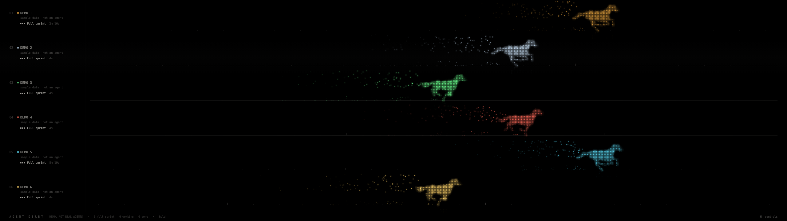
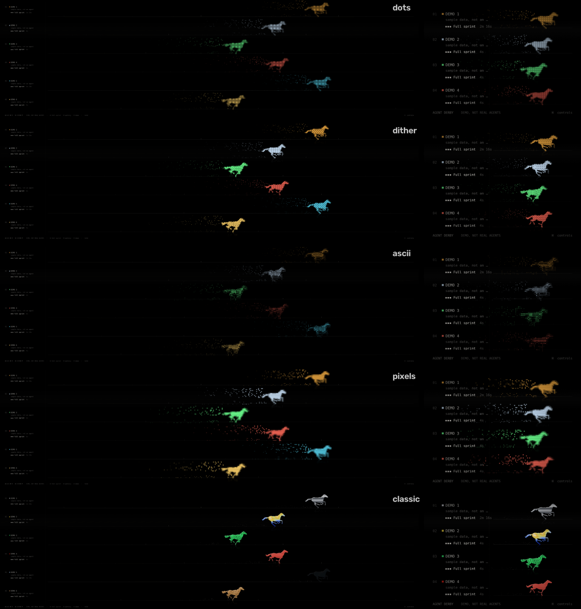

# Agent Derby

A horse race for your AI coding agents. Every agent gets a lane. A horse that's done stands still, a working one trots, and a busy one gallops. Leave it running on a spare screen, an ultrawide, a tube TV or a Raspberry Pi and see at a glance who's busy.



*The screenshot shows demo horses. Real agents replace them once the bridge is running.*

## What's in here

| File | What it does |
| --- | --- |
| `index.html` | The race. One self-contained page, no build step. |
| `bridge.mjs` | A tiny local server (Node 18+, no dependencies). It collects agent status and serves the page at http://127.0.0.1:4777/. |
| `hook.sh` | The hook that Claude Code and Cursor call to report status. |
| `setup.mjs` | Adds or removes the hooks for you. It backs up each settings file first. |
| `derby-run.sh` | Wraps any command so it shows up as a horse while it runs. |
| `autostart.sh` | macOS: starts the bridge at login and restarts it if it stops. `on`, `off`, `status`. |
| `derby-mcp.mjs` | Optional read-only MCP server so the Claude desktop app can read the bridge's status. |
| `xcode-build-*.sh` | Optional Xcode behaviors for build started and finished. |
| `derby.config.example.json` | Every setting, with defaults. Copy it to `derby.config.json`. |

## Quick start (macOS or Linux)

```sh
git clone <this repo> ~/agent-derby
cd ~/agent-derby
cp derby.config.example.json derby.config.json   # optional, defaults work without it
node bridge.mjs
```

Open http://127.0.0.1:4777/. Until an agent reports in, lanes show as open. Open `index.html` straight from disk and you get labeled demo horses instead.

### Start at login (macOS)

Stop the bridge you started by hand first (Control+C), since only one can use the port. Then:

```sh
~/agent-derby/autostart.sh on       # start now, at every login, and again if it stops
~/agent-derby/autostart.sh status   # is it on, and is the page answering?
~/agent-derby/autostart.sh off      # stop it and remove the login item
```

It writes a LaunchAgent at `~/Library/LaunchAgents/com.agentderby.bridge.plist` using whichever `node` is on your PATH, and logs to `bridge.log` in the folder. Run `on` again after editing `derby.config.json` or switching Node versions.

## Hook up your agents

**Claude Code and Cursor.** In a second terminal:

```sh
node ~/agent-derby/setup.mjs claude   # Claude Code hooks
node ~/agent-derby/setup.mjs cursor   # Cursor hooks
node ~/agent-derby/setup.mjs desktop  # optional: the read-only server for the Claude desktop app (macOS)
node ~/agent-derby/setup.mjs remove   # take them all out again
```

Restart open sessions to pick them up. Each session becomes a horse named after the tool, with the project folder name as its task.

**Xcode (macOS).** The bridge notices `xcodebuild` and Xcode build processes on its own. Turn it off with `"xcode": false`.

**TestFlight (optional, read-only).** Add a `testflight` section to `derby.config.json` with your own App Store Connect API key. The bridge only makes GET requests.

```json
"testflight": { "label": "My App", "bundleId": "com.example.app", "issuerId": "...", "keyId": "...", "keyPath": "~/keys/AuthKey.p8", "everySeconds": 120 }
```

Keep `derby.config.json` out of git (the `.gitignore` already does).

**Any other script or bot.** Either wrap it:

```sh
~/agent-derby/derby-run.sh my-bot "My Bot" "ops" -- python3 ~/bots/my_bot.py
```

or add a `watch` entry with a unique part of its command line (find it with `ps -axo args`), or post events yourself:

```sh
curl -s -H 'X-Derby: 1' -d '{"agent":"my-bot","name":"My Bot","task":"ops","state":"work"}' http://127.0.0.1:4777/event
```

`state` is `work`, `sprint`, `done` or `end` (removes the lane).

## Put it on a screen

- **Live wallpaper (macOS):** add http://127.0.0.1:4777/ as a website in [Plash](https://sindresorhus.com/plash).
- **Screensaver (macOS):** set the URL in [WebViewScreenSaver](https://github.com/liquidx/webviewscreensaver).
- **Any browser:** open the page and press F for fullscreen. H shows the controls.

### Old screens: tube TVs, old iMacs, 4:3 monitors

The page switches on its own to a chunky 4:3 layout when the screen is close to square, at 1024x768 or 640x480. Names sit in a column on the left and there's a wide safe margin, because tube TVs crop their edges. Force a layout with `?layout=4x3` or `?layout=wide`, or set `"layout"` in the config.

### Raspberry Pi or another device on your Wi-Fi

1. Set `"shareOnWifi": true` in `derby.config.json` (or run `DERBY_SHARE=1 node bridge.mjs` for one run).
2. Restart the bridge. If your Mac asks whether node may accept incoming connections, allow it.
3. The bridge prints an address like http://your-computer.local:4777/. Open it on the Pi in fullscreen.

**What Wi-Fi sharing exposes.** It's off by default. When it's on, any device on your home network can load the page and read the live status feed: agent names, project folder names (not full paths), build versions and each agent's state. It never exposes prompts, code, files or keys. Devices on the network can only read; only the computer running the bridge can send events. Requests from addresses outside private home ranges (10.x, 172.16-31.x, 192.168.x, link-local) are refused. Don't turn it on for a shared or public network.

## Settings

Everything lives in `derby.config.json`. Every key is optional.

| Key | Default | What it does |
| --- | --- | --- |
| `port` | `4777` | Port the bridge listens on. `DERBY_PORT` overrides it. |
| `shareOnWifi` | `false` | Serve the page and status to your home network. `DERBY_SHARE=1` overrides it. |
| `sprintToolCallsPerMinute` | `12` | Tool calls in the last minute that count as a full sprint. |
| `keepDoneMinutes` | `30` | How long a finished agent keeps its lane. |
| `staleMinutes` | `10` | A busy agent with no events this long counts as done. |
| `xcode` | `true` | Watch for Xcode builds (macOS). |
| `watch` | `[]` | Processes to show as horses: `agent` (id), `name`, `task`, `match` (part of the command line). |
| `testflight` | off | Read-only TestFlight build status, see above. |
| `page.layout` | `"auto"` | `"auto"`, `"32x9"` or `"4x3"`. A `?layout=` in the address wins. |
| `page.horseStyle` | `"dots"` | `dots`, `dither`, `ascii`, `pixels` or `classic`. See Looks below. |
| `page.palette` | `"lanes"` | `lanes` (a color per lane), `amber`, `green`, `white`, `ice`, or one 6-digit hex color. |
| `page.crtOverlay` | `0.15` | CRT layer strength, 0 (off) to 1. Defaults to 0.25 on the 4:3 layout. |
| `page.title` | `"AGENT DERBY"` | Text in the footer. |
| `page.theme.background` | `"#000000"` | Background color (6-digit hex). |
| `page.theme.ink` | `"#ECE9E2"` | Text and track color (6-digit hex). |
| `page.horses` | all 8 | Textures for the `classic` look, lane by lane, repeating if shorter: `chrome`, `thermal`, `type`, `dots`, `glass`, `leopard`, `cobalt`, `glitter`. |
| `page.track.lines` | `true` | Draw the track lines and distance posts. |
| `page.track.reflections` | `true` | Draw the horses' reflections. |
| `page.track.dust` | `true` | Kick up dust at a gallop. |
| `page.labels.showTask` | `true` | Show the project or task under each name. |
| `page.labels.showTimer` | `true` | Show how long each agent has been in its state. |
| `page.labels.rename` | `{}` | Display names, for example `{ "Claude Code": "Claude" }`. |

The page reads the `page` section from the bridge at `/config` when it loads, so reload it after changing settings. The bridge itself needs a restart for the other keys.

## Looks

The horses are drawn in one of five looks. Press V on the page to flip through them, or pick one in settings:

- **dots** (the default): glowing LED dots with a soft bloom.
- **dither**: 1-bit ordered dither, like an old Mac screen.
- **ascii**: the horse built from text characters, brighter parts in denser characters.
- **pixels**: chunky pixels in four shades.
- **classic**: the original textured horses.

The state shows in the light itself. A done horse thins out to a few dim, twinkling dots. A working horse fills in. A horse at full sprint glows brightest and leaves a trail of points behind it. A soft CRT layer (scanlines, a vignette, a slow rolling band and a faint flicker) sits over everything at about 15%, a bit heavier on the 4:3 layout.

The gallop is traced from Eadweard Muybridge's 1878 photographs *The Horse in Motion* (Sallie Gardner at a gallop, Palo Alto, 19 June 1878). The scan used is the Library of Congress copy on Wikimedia Commons, which is in the public domain. Each of the 11 gallop frames was cut out, the rider removed, and the outline stored inside the page as plain shape data, so every look (dots, dither, ascii, pixels, classic) is drawn from Muybridge's horse. The trot and the resting horse are still drawn by code. Credit: Eadweard Muybridge, *The Horse in Motion*, 1878.

If the page runs slowly (a Raspberry Pi, a very large screen), it drops the bloom and reflections first, then uses coarser cells, and comes back up when frames are fast again.



## Address options

`?layout=4x3|wide|auto`, `?style=dots|dither|ascii|pixels|classic`, `?palette=amber`, `?crt=0.3`, `?lanes=1-8` (minimum lanes), `?demo=0` (freeze the demo), `?live=1` (poll a bridge when served over https).

## Privacy

Everything runs on your own computer. The bridge listens on 127.0.0.1 only unless you turn on Wi-Fi sharing, makes no outbound requests except the optional read-only TestFlight check, and keeps status in memory only.

## License

MIT. See [LICENSE](LICENSE).

## Improving the visuals with Claude Code
This folder is set up for Claude Code. `CLAUDE.md` holds the project rules, `docs/STYLE.md` the art direction and `docs/MOTION.md` the motion rules. `npm run qa` takes headless screenshots and motion contact sheets into `docs/qa/`, and two review agents (`design-critic`, `motion-reviewer`) judge them. Start a session with `claude --model claude-fable-5-2` and paste the prompt in `docs/START-PROMPT.md`.
